# Household Electricity Consumption Prediction Using Machine Learning

A complete, end-to-end Machine Learning web application that predicts daily household electricity consumption in **kilowatt-hours (kWh/day)** and calculates an **estimated monthly consumption (kWh/month)** based on household demographic details, appliance counts, usage patterns, and ambient outdoor temperature.

Developed with **Python**, **Flask**, **Scikit-learn**, and a clean, light-themed responsive web user interface.

---

## 📌 Project Overview

Accurate prediction of household electricity consumption assists consumers and utility planners in managing energy efficiency, estimating electricity expenditures, and optimizing heavy appliance schedules. This project provides a full ML pipeline with data preprocessing, exploratory data analysis (EDA), multi-model training and evaluation, serialized model inference, and local prediction history logging.

### Input Features & Target Variable

| Feature Name | Column in CSV | Data Type | Description | Realistic Range |
| :--- | :--- | :--- | :--- | :--- |
| **People** | `People` | Integer | Number of occupants residing in the house | 1 – 8 |
| **AC Usage Hours** | `AC_Usage_Hours` | Float | Air conditioning operating duration per day | 0.0 – 16.0 hrs |
| **Number of Fans** | `Number_of_Fans` | Integer | Total ceiling/table fans in regular use | 1 – 8 |
| **Electrical Appliances** | `Number_of_Appliances`| Integer | Active household appliances (Fridge, TV, PC, Washing machine) | 2 – 16 |
| **Daily Usage Hours** | `Daily_Usage_Hours` | Float | General active electricity duration in the house | 4.0 – 20.0 hrs |
| **Outside Temperature** | `Outside_Temperature` | Float | Ambient outdoor temperature in Celsius (°C) | 18.0 – 43.0 °C |
| **Previous Consumption**| `Previous_Consumption`| Float | Baseline consumption from previous day/monitoring cycle | 3.5 – 55.0 kWh/day |
| **Electricity Consumption** *(Target)* | `Electricity_Consumption` | Float | **Target Variable:** Total daily electricity consumption | **kWh/day** |

---

## ⚙️ Technologies Used

- **Programming Language:** Python 3.10+
- **Backend Framework:** Flask 3.x
- **Data Processing:** Pandas, NumPy
- **Machine Learning:** Scikit-learn (Linear Regression, Decision Tree, Random Forest)
- **Visualization:** Matplotlib, Seaborn
- **Model Serialization:** Joblib
- **Database:** SQLite3 (Local prediction history log)
- **Frontend:** HTML5, CSS3 (Modern Light Theme), JavaScript

---

## 📊 Dataset & Synthetic Data Disclosure

- **Location:** `data/household_electricity.csv`
- **Dataset Size:** 600 records × 8 columns
- **Synthetic Data Disclosure:** The dataset used in this project is a physically grounded **synthetic dataset** generated via `train_model.py`. The generation algorithm simulates realistic household base electrical loads (refrigeration, standby power), occupant power usage, temperature-dependent AC cooling duty cycles, and day-to-day consumption momentum. All synthetic records are clearly documented and labeled.

---

## 🧠 Machine Learning Workflow

```mermaid
flowchart LR
    A["1. Synthetic Dataset Generation<br/>(data/household_electricity.csv)"] --> B["2. Data Preprocessing & Cleaning<br/>(Missing values, Duplicates, Types)"]
    B --> C["3. Exploratory Data Analysis<br/>(Matplotlib / Seaborn Visuals)"]
    C --> D["4. Train-Test Split (80:20)<br/>(random_state=42)"]
    D --> E["5. Model Training & Comparison<br/>(Linear Reg, Decision Tree, Random Forest)"]
    E --> F["6. Model Selection & Joblib Save<br/>(models/electricity_model.pkl)"]
    F --> G["7. Flask Web App & Inference<br/>(Daily kWh + Monthly Estimate)"]
    G --> H["8. SQLite History Logging<br/>(predictions.db)"]
```



### Models Compared:
1. **Linear Regression**
2. **Decision Tree Regressor** (`max_depth=6`, `min_samples_split=5`)
3. **Random Forest Regressor** (`n_estimators=100`, `max_depth=8`)

### Evaluation Metrics (Evaluated on 20% Unseen Test Set):
- **Mean Absolute Error (MAE)**
- **Mean Squared Error (MSE)**
- **Root Mean Squared Error (RMSE)**
- **Coefficient of Determination ($R^2$ Score)**

The model with the lowest Test RMSE is automatically saved to `models/electricity_model.pkl`.

---

## 📁 Project Structure

```text
HouseholdElectricityPrediction/
├── app.py                      # Flask web application server & routing
├── train_model.py              # ML pipeline: data generation, EDA, training, evaluation
├── requirements.txt            # Python package dependencies
├── README.md                   # Comprehensive project documentation
├── predictions.db              # SQLite3 database storing prediction history (auto-created)
├── data/
│   └── household_electricity.csv   # Dataset (600 records)
├── models/
│   ├── electricity_model.pkl       # Serialized best trained ML model (Joblib)
│   └── metadata.json               # Pre-computed evaluation metrics and dataset info
├── static/
│   ├── style.css                   # Responsive modern light-theme stylesheet
│   └── plots/                      # Generated Matplotlib charts
│       ├── consumption_dist.png    # 1. Target distribution histogram + KDE
│       ├── ac_vs_consumption.png   # 2. AC usage vs Electricity consumption
│       ├── temp_vs_consumption.png # 3. Outside temperature vs Consumption
│       ├── prev_vs_actual.png      # 4. Previous consumption vs Current consumption
│       ├── correlation_heatmap.png # 5. Feature correlation heatmap
│       ├── model_comparison.png    # 6. Model performance comparison bar chart
│       └── actual_vs_predicted.png # 7. Actual vs Predicted scatter plot
└── templates/
    └── index.html                  # Main web dashboard interface
```

---

## 🚀 Installation and Execution Guide

### Step 1: Clone or Navigate to Project Directory
```bash
cd "Household Electricity Consumption Prediction"
```

### Step 2: (Optional) Create and Activate a Virtual Environment
```bash
# Windows:
python -m venv venv
venv\Scripts\activate

# macOS / Linux:
python3 -m venv venv
source venv/bin/activate
```

### Step 3: Install Required Dependencies
```bash
pip install -r requirements.txt
```

### Step 4: Run Machine Learning Training Pipeline
This script generates the dataset, produces all EDA charts in `static/plots/`, trains all regression models, calculates evaluation metrics, and saves the best model.
```bash
python train_model.py
```

### Step 5: Start the Flask Web Application
```bash
python app.py
```

### Step 6: Open the Web Application
Open your browser and navigate to:
```
http://127.0.0.1:5000
```

---

## 📸 Presentation & Screenshot Guide (College Mini-Project)

The web dashboard is organized with distinct labeled cards matching the required project figures:

- **Fig. 1 — Dataset Overview:** Displays total dataset size (600 samples), 7 input feature descriptions, and a table preview of the first 6 records.
- **Fig. 2 — Data Preprocessing:** Displays zero-missing-value verification, data types, 0 duplicates, and 80:20 train-test partitioning details.
- **Fig. 3 — Exploratory Data Analysis (EDA):** Displays 5 graphs generated from data: Distribution histogram, AC vs kWh, Temp vs kWh, Prev vs Actual kWh, and Correlation Heatmap.
- **Fig. 4 — Model Training & Comparison:** Comparison table of Linear Regression, Decision Tree, and Random Forest showing MAE, MSE, RMSE, R² alongside the comparative bar chart.
- **Fig. 5 — Model Evaluation:** Detailed MAE, MSE, RMSE, and R² metric cards with the Actual vs. Predicted scatter plot.
- **Fig. 6 — Electricity Consumption Prediction:** Interactive input form with default test parameters, real model-driven prediction (**Predicted Daily Consumption: X.XX kWh/day**), and estimated monthly reading (**Estimated Monthly Consumption: X.XX kWh/month**).
- **Recent Prediction History Log:** SQLite3 table showing recent queries and prediction results with a clear history option.

---

## 💡 Monthly Consumption Calculation
The estimated monthly electricity consumption is calculated as:
$$\text{Estimated Monthly Consumption (kWh/month)} = \text{Predicted Daily Consumption (kWh/day)} \times 30$$
*Note: This is labeled as an estimate for consumer budget planning, not an actual electric billing meter invoice.*

---

## 📜 License
Developed for academic machine learning mini-project demonstration. Free to use, adapt, and build upon.
